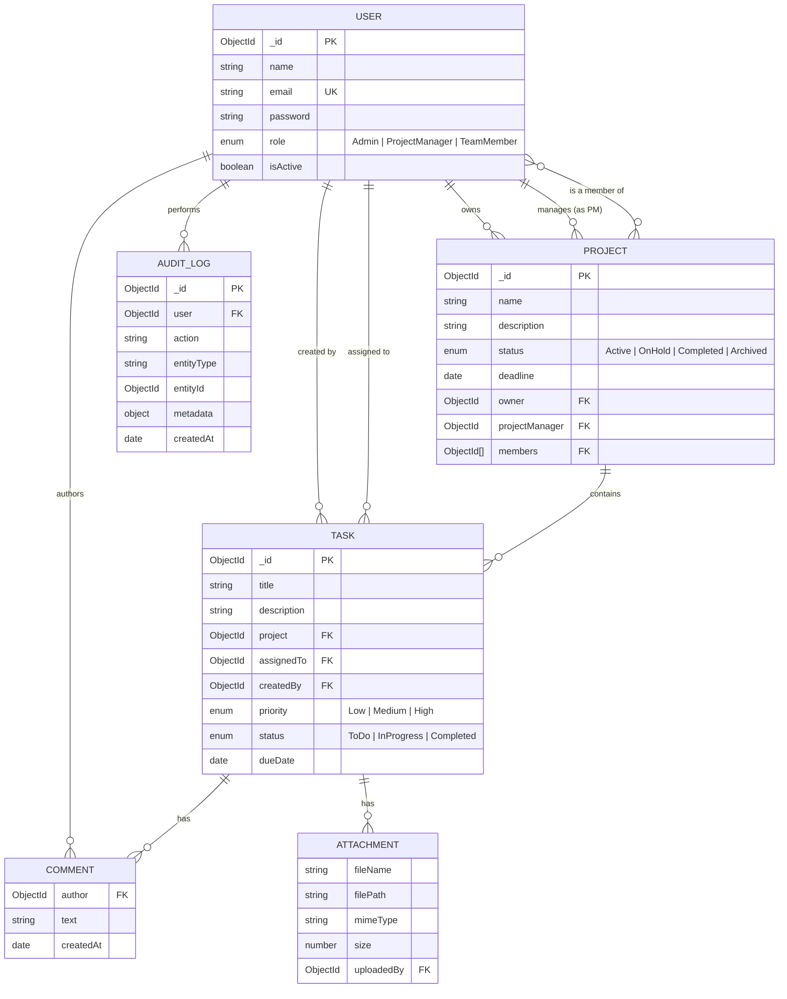

# ProjectFlow — Project & Task Management Platform

A full-stack MERN application for organizations to manage projects, teams, and tasks with
role-based access control, task tracking, comments, file attachments, and a live dashboard.

## Tech Stack

| Layer     | Technology |
|-----------|------------|
| Frontend  | React 18, Vite, React Router, Recharts, Axios |
| Backend   | Node.js, Express, JWT, bcrypt, Multer, express-validator |
| Database  | MongoDB (Mongoose ODM) |
| Docs      | Swagger / OpenAPI (`/api/docs`), Postman collection |
| Testing   | Jest + Supertest + mongodb-memory-server |
| Infra     | Docker, docker-compose, Nginx (frontend serving + API proxy) |

## Features

- **Auth**: registration, login, JWT-based sessions, secure password hashing (bcrypt)
- **RBAC**: `Admin`, `ProjectManager`, `TeamMember` roles enforced server-side on every route
- **Projects**: create/update/delete, assign a Project Manager, add/remove team members, deadlines, search/filter/pagination
- **Tasks**: create/assign/edit/delete, priority (Low/Medium/High), status (To Do/In Progress/Completed), due dates, comments, file attachments
- **Dashboard**: per-project progress bars, task statistics, completed vs pending breakdown, upcoming deadlines, team performance/completion-rate chart
- **Cross-cutting**: input validation, centralized exception handling, audit logs (who did what, when), rate limiting on auth routes, Helmet + CORS + Mongo sanitization

## Project Structure

```
project-management-app/
├── backend/
│   ├── config/          # DB connection, Swagger config
│   ├── controllers/     # Route handler logic
│   ├── middleware/      # auth, RBAC, error handling, audit logging
│   ├── models/          # Mongoose schemas: User, Project, Task, AuditLog
│   ├── routes/          # Express routers
│   ├── utils/           # JWT helper, file upload config
│   ├── tests/           # Jest + Supertest suites
│   ├── app.js           # Express app (exported for tests)
│   ├── server.js        # Entry point (connects DB, starts listener)
│   └── Dockerfile
├── frontend/
│   ├── src/
│   │   ├── api/         # Axios instance with JWT interceptor
│   │   ├── context/     # AuthContext (global user/session state)
│   │   ├── components/  # Navbar, ProtectedRoute, Badges
│   │   ├── pages/        # Login, Register, Dashboard, Projects, ProjectDetail, Tasks
│   │   └── App.jsx
│   ├── nginx.conf
│   └── Dockerfile
├── docker-compose.yml
├── API_DOCUMENTATION.md
├── postman_collection.json
└── README.md
```

## Data Model / ER Diagram



Comments and Attachments are embedded sub-documents on `Task` (not separate collections) — the
diagram shows them as entities for clarity, but they live inside `task.comments[]` and
`task.attachments[]`.

## Role-Based Access Summary

| Action                          | Admin | Project Manager | Team Member |
|----------------------------------|:-----:|:----------------:|:-----------:|
| Create / delete project          | ✅    | ✅ (own)          | ❌ |
| Assign PM / add members          | ✅    | ✅ (own projects) | ❌ |
| Create / edit / delete task      | ✅    | ✅                | ❌ (create/delete) |
| Update status of assigned task   | ✅    | ✅                | ✅ |
| Comment on task                  | ✅    | ✅                | ✅ |
| Upload attachment                | ✅    | ✅                | ✅ |
| View dashboard (org-wide)        | ✅    | ✅                | own tasks/projects only |
| Manage user roles                | ✅    | ❌                | ❌ |

## Local Development (without Docker)

**Prerequisites:** Node.js 20+, MongoDB running locally (or a connection string to Atlas).

```bash
# 1. Backend
cd backend
cp .env.example .env      # edit MONGO_URI / JWT_SECRET as needed
npm install
npm run dev                # starts on http://localhost:5000

# 2. Frontend (in a new terminal)
cd frontend
npm install
npm run dev                # starts on http://localhost:5173, proxies /api to :5000
```

Visit `http://localhost:5173`, register an account, and start creating projects. The first
user you register can be promoted to `Admin` directly in MongoDB (`db.users.updateOne(...)`)
since self-registration only allows `TeamMember` / `ProjectManager` for safety.

## Running with Docker

```bash
# from the repo root
cp backend/.env.example backend/.env   # optional, compose sets sane defaults
docker-compose up --build
```

- Frontend: http://localhost:5173
- Backend API: http://localhost:5000/api
- Swagger docs: http://localhost:5000/api/docs

## Running Tests

```bash
cd backend
npm install
npm test
```

Tests spin up an in-memory MongoDB (`mongodb-memory-server`), so no external database is
required. Coverage includes registration/login, JWT-protected routes, and RBAC enforcement
(e.g. a Team Member cannot create a project or a task, but can update the status of a task
assigned to them).

## API Documentation

- Interactive Swagger UI: `GET /api/docs` once the backend is running
- Static reference: see [`API_DOCUMENTATION.md`](./API_DOCUMENTATION.md)
- Postman collection: [`postman_collection.json`](./postman_collection.json) — import into
  Postman, set the `baseUrl` and `token` collection variables (the login/register requests
  auto-populate `token` via a test script)

## Deployment Notes

This repository is deployment-ready but is not hosted at a live URL by default. To deploy:

- **Backend**: any Node host (Render, Railway, Fly.io, an EC2/VPS running the Docker image) +
  a managed MongoDB (Atlas). Set `MONGO_URI`, `JWT_SECRET`, `CLIENT_URL` env vars.
- **Frontend**: build with `npm run build` and serve the `dist/` folder as a static site
  (Vercel, Netlify, Cloudflare Pages) or use the provided Nginx Docker image. Point
  `VITE_API_URL` at your backend's public URL.
- **Docker Compose** works as-is on a single VPS for a quick all-in-one deployment.

## Security Notes

- Passwords are hashed with bcrypt (never stored in plaintext)
- JWTs are short-lived and verified on every protected request
- `express-mongo-sanitize` strips NoSQL-injection operators from input
- `helmet` sets standard security headers; CORS is restricted to `CLIENT_URL`
- Rate limiting is applied to `/api/auth/*` to slow brute-force attempts
- All destructive/role-sensitive actions are recorded in the `AuditLog` collection
